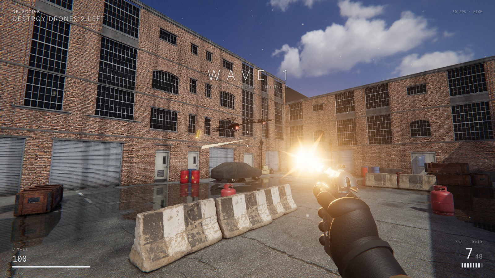

# BRICKYARD

A tiny first-person shooter that runs in the browser: one walled factory yard, one pistol, three waves of sentry drones.
The scope is deliberately small; the effort went into how it looks.



## Run

No build step. Serve this folder with any static file server and open it in a desktop browser (Chrome, Edge, Firefox or Safari with WebGL 2):

```bash
cd fps
python3 -m http.server 8000
# open http://localhost:8000
```

Opening `index.html` straight from disk does not work, because browsers block ES modules and asset fetches on `file://`.

## Two modes

- `index.html` is BRICKYARD: three waves of sentry drones, played straight.
- `rage.html` is QUALIFICATION DAY, a rage-game take on the same yard. "Control" gives you orders over the radio and
  nearly all of them are lies: the ammo box is a bomb, the target drone dodges only when you aim properly, the
  recommended cover is a propane tank, the extraction door keeps moving. Dying costs two seconds. The last order is
  the true one, and by then you will not want to follow it. The mode lives in `src/rage.js`.

## Controls

| Input | Action |
|-------|--------|
| `W A S D` | move |
| mouse | look |
| left mouse | fire |
| right mouse | aim down sights |
| `Shift` | sprint |
| `Space` | jump |
| `C` | crouch |
| `R` | reload |
| `G` | cycle graphics preset (low / medium / high) |
| `M` | mute |
| `Esc` | pause |

Shoot the red sensor eye of a drone for a critical hit. Propane tanks explode. Ammo boxes glow faintly and respawn.
A drone that is already falling can be shot again to detonate it in the air.

## What is in the renderer

- Physically based materials on photoscanned assets, lit by an HDRI sky. The sun is measured out of the HDRI
  (direction, colour, irradiance), removed from the environment map and re-added as a shadow-casting directional light.
- Planar reflections: the scene is rendered a second time from a mirrored camera and sampled by the wet asphalt, so
  puddles reflect the buildings, props, drones and explosions. The puddles themselves come from a world-space noise mask.
- Ground-truth ambient occlusion (GTAO), HDR bloom, ACES tone mapping, 4x MSAA.
- Lens pass: sun glare with streak and ghosts (only when the sun is actually visible), chromatic aberration,
  vignette, film grain, sharpening.
- Procedural weathering in the wall shaders (tonal blotches, rain streaks, dirt near the ground) to hide the tiling of
  the modular facade kit, plus worn road paint in the ground shader.
- Separate view-model pass for the pistol so it never clips into walls; its key light fades when you stand in shadow.
- Effects: muzzle flash with a dynamic light, ejected brass, tracers, sparks, dust, bullet holes, explosions, scorch marks.
- All audio is synthesised with WebAudio (gunshot, impacts, drone rotors, explosions, courtyard reverb); there are no sound files.

The graphics preset drops automatically if the frame rate stays under 30 fps; press `G` to choose one yourself.
`?q=low`, `?q=medium` or `?q=high` in the URL pins a preset.

## Layout

```
index.html        page, HUD and menu
src/main.js       scene setup, lighting, game rules, HUD, main loop
src/assets.js     model / texture / HDRI loading, sun extraction
src/renderer.js   renderer and post-processing chain
src/level.js      facade kit assembly, ground shader, props, collision boxes
src/player.js     first-person controller and collision
src/weapon.js     pistol view-model, firing, recoil, reload
src/enemies.js    drones and their projectiles
src/rage.js       QUALIFICATION DAY: the lying-radio rage mode
src/fx.js         pooled particles, decals, tracers, debris
src/audio.js      synthesised sound
vendor/three      three.js r187 (module build and the add-ons used)
assets/           models (GLB, meshopt + WebP), ground textures, HDRI
```

## Credits and licences

- Models, textures and the HDRI are from [Poly Haven](https://polyhaven.com) and are CC0 (public domain):
  `service_pistol`, `modular_factory_facade`, `modular_chainlink_fence`, `concrete_road_barrier`, `covered_car`,
  `Barrel_01`, `barrel_03`, `propane_tank`, `wooden_military_crate`, `old_tyre`, `portable_generator`, `ammo_box`,
  `metal_trash_can`, `utility_box_01`, `cardboard_box_01`, `trashbag`, `street_lamp_01`, the `asphalt_02` texture and the
  `kloofendal_48d_partly_cloudy_puresky` HDRI. They were repacked to GLB with meshopt compression and WebP textures,
  and a few dense meshes were decimated.
- [three.js](https://threejs.org) is MIT licensed; see `vendor/three/LICENSE`.
- The drones, the gloved hand, all effects and all sounds are generated in code.
